# Waarom optica?

note:

- VR headsets voor de consument zijn duidelijk bruikbaar, maar...
- tekortkomingen (misselijkheid, hoofdpijn,...) hebben aanwijsbare oorzaken
- sommige ervaringen zijn niet geschikt voor de technologie
  - bv. voorwerp in VR heel dicht bij gezichtsveld brengen: niet *nodig* dat onze ogen extra focussen, maar ze gaan het toch proberen
- sommige effecten vereisen dat we weten wat gaande is
  - om ze zelf te bereiken
  - om ze zelf weg te werken
- om het effect van allerlei sliders in je game engine te kaderen (termen zoals "specularity", "diffusion",...)
- om te begrijpen hoe een headset gebouwd is en waarom specifieke onderdelen aanwezig zijn

---

## Licht

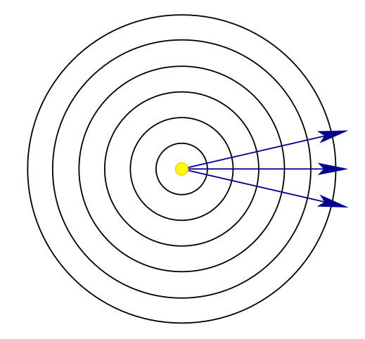

note:

- als deeltjes (fotonen)
  - nuttig om te redeneren over sensoren
- als (elektromagnetische) golf
  - nuttig om te redeneren over kleur
- als straal (van fotonen)
  - nuttig om te redeneren over line-of-sight,...
- moderne fysica verklaart dat deze modellen onderling compatibel zijn

---

## Oneindig verre lichtbron

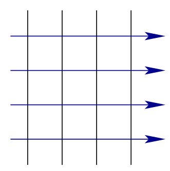

note:

- beeld in dat vorige afbeelding extreem ver ingezoomd is op een van de golffronten (cirkels)
- belangrijk dit geval te overwegen, want we werken vaak met een "zon"
- belangrijk om de basiswerking van lenzen uit te leggen

---

## Interactie met materialen

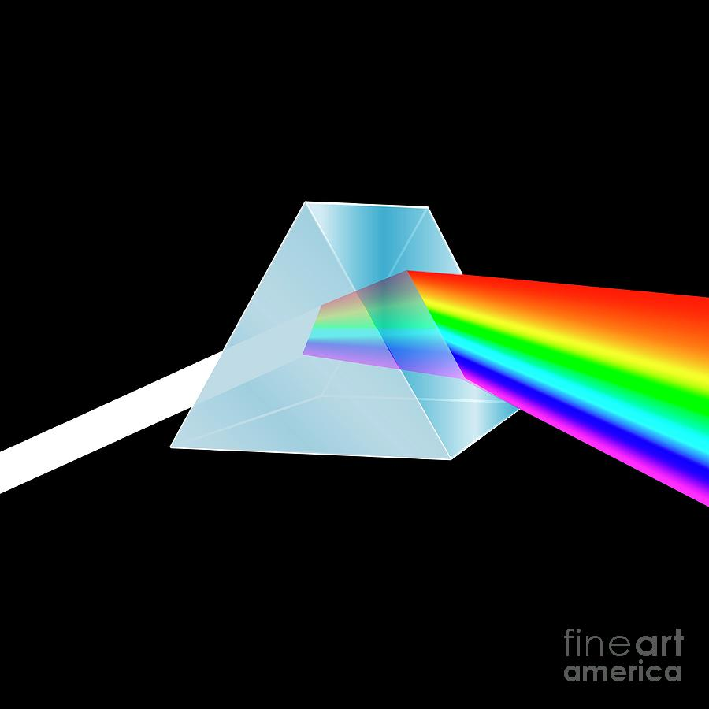
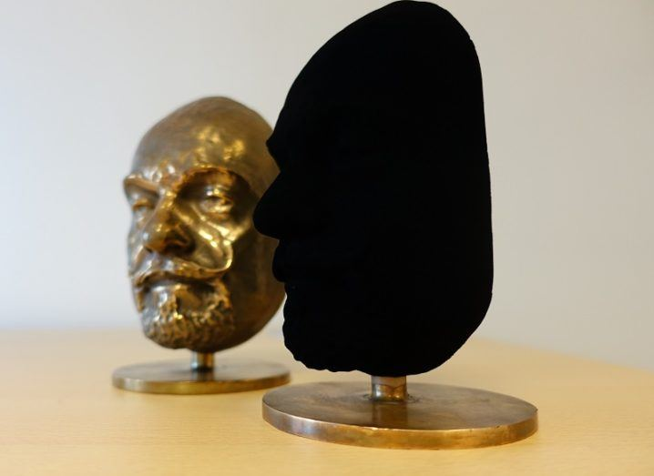

note:

- transmissie (doorlaten, met versnelling/vertraging en wijziging hoek, zie wet van Snellius)
- absorptie (licht komt vast te zitten)
- reflectie
  - speculair (alle lichtstralen weerkaatsen met zelfde hoek, bv. bij perfecte spiegel)
  - diffuus (vervorming hoek bij weerkaatsing)

---

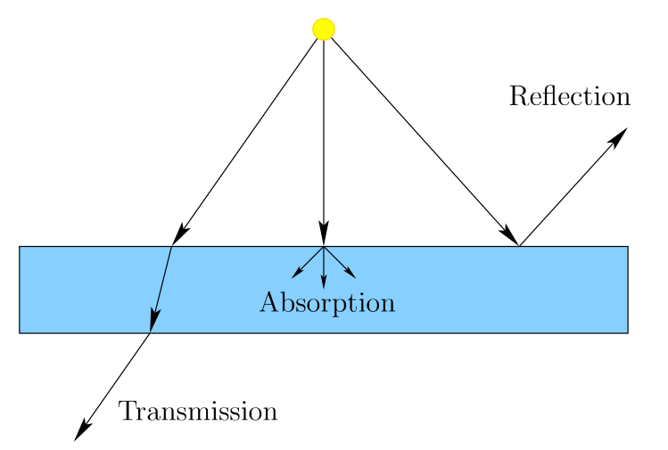

---

## Zichtbaar licht

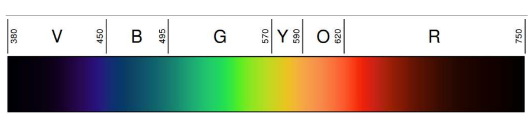

note:

- kijken bijna nooit recht naar de bron
- we zien een weerkaatsing
- kleur die we zien moet aanwezig zijn in de bron (zie prisma: wit licht is "som" van allerlei vormen gekleurd licht) **en** moet weerkaatst worden door oppervlak (zie Vanta black)

---

<section>
$f = \frac{s}{\lambda}$
</section>

note:

- frequentie = snelheid / golflengte
  - snelheid **in een medium** wordt eigenlijk ook beïnvloed door golflengte
  - hier is `s` gelijk aan `c` indien we het over vacuüm hebben (dus snelheid is gelijk)

---

## Buiging

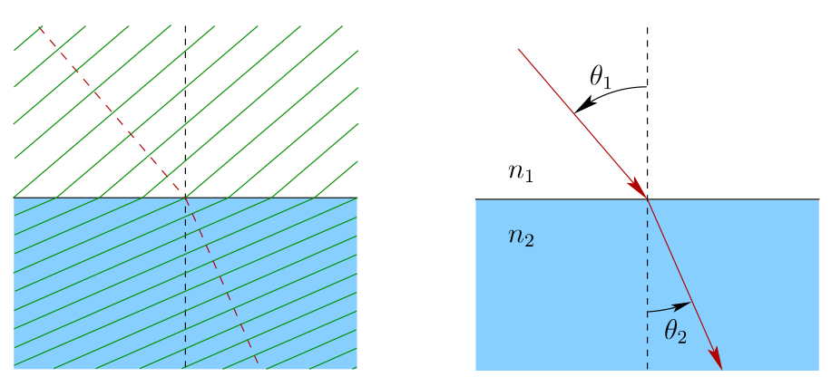

note:

- remember: parallelle lijnen en dus ook parallelle golffronten loodrecht daarop
- overvang van medium verandert de hoek
- deze buiging berekenen staat ons toe visuele informatie bij te stellen
  - m.a.w. lenzen te maken

---

<section>
$n = \frac{c}{s}$
</section>

note:

- n = refractie-index
- betekent hoe veel langer het duurt om door het medium te gaan
  - 1.000293 voor lucht
  - 1.33 voor water
  - 1.523 voor kroonglas, i.e. glas voor lenzen
  - regenboog: water in de lucht, licht passeert door meer water en wordt gebroken

---

## Wet van Snellius

<section>
$n_1 sin(\theta_1) = n_2 sin(\theta_2)$
</section>

note:

- gevolg: `n1 < n2` betekent dat tweede hoek meer gealigneerd is met materiaal
- omgekeerd: sinus ligt normaal tussen 0 en 1, dus als `(n1 /n2 ) sin θ1 > 1`, dan kan het effect spiegeling zijn
  - kan gebeuren als je van onder water naar oppervlak kijkt
  - ook hoe glasvezel werkt

---

## Simpele convexe lens

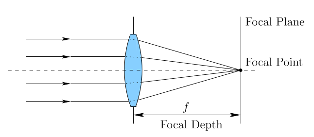
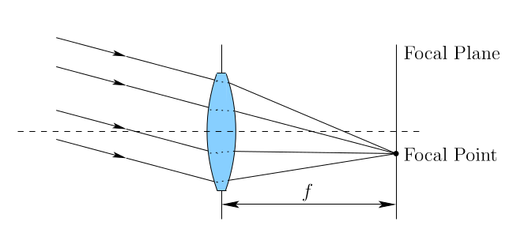

note:

- convex = bolvormig
- stippellijn = optische as
  - ideaal is dat deze parallel loopt met de lichtstralen en door het midden van de lens
- licht van parallelle stralen komt samen op het **brandpunt** van de lens ("focal point")
- brandpuntsafstand = afstand tussen lens en brandpunt
- brandvlak ("focal plane") omdat stralen die niet evenwijdig zijn niet op dat punt komen, maar verschoven in een vlak

---

## Objecten dichtbij

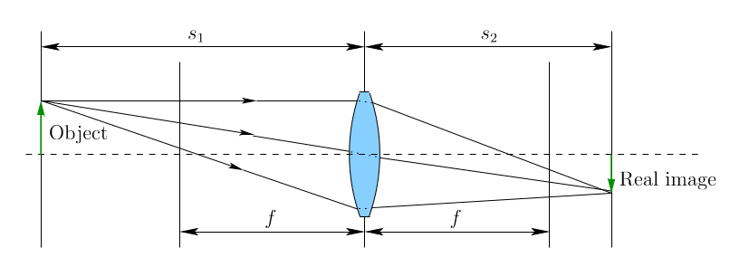

note:

- echt object is niet oneindig ver, stralen komen niet evenwijdig binnen
  - gevolg: beeld komt niet terecht in het brandpunt en ook niet in het brandvlak, maar er achter
    - oogspieren vangen dit op door lens "aan te trekken"
    - iets om rekening mee te houden, als ons brein denkt dat iets dichtbij is, kan dit gebeuren, ook als het eigenlijk niet nodig is

---

## Uitvergroting

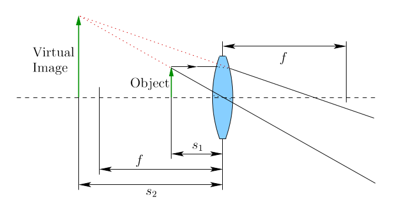

note:

- wat lenzen in een VR-headset doen (gaat hier niet om de lenzen van het oog)
- object (de display) is heel dichtbij (op afstand s1)
- dus virtueel beeld lijkt "oneindig" ver (op afstand s2)
- en het hele systeem gedraagt zich uiteindelijk alsof het oog dus een enorm beeld op een enorme afstand ziet

---

## Niet-parallelle stralen scherp beeld laten vormen

<section>
$\frac{1}{s_1} + \frac{1}{s_2} = \frac{1}{f}$
</section>

note:

- `s_1` is de afstand tot de lichtbron
- `s_2` is de afstand tot waar het beeld uiteindelijk uitkomt
- `f` is dus brandpuntsafstand
- parallelle stralen komen van een oneindig verre lichtbron en dan valt het beeld dus op het brandvlak
  - en als ze loodrecht op de lens vallen, op het brandpunt zelf
- af te leiden uit wet van Snellius
- zoals bij "objecten dichtbij": er is een scherp beeld maar niet op ideale afstand, oogspieren kunnen opvangen door aan te trekken
- echte objecten zijn niet vlak en we kijken niet recht naar het geheel, dus altijd een benadering

---

## Chromatische aberratie

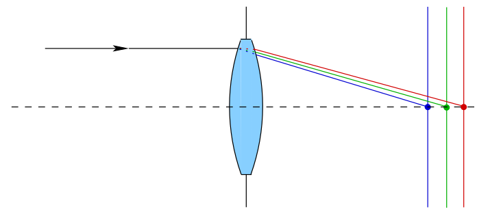
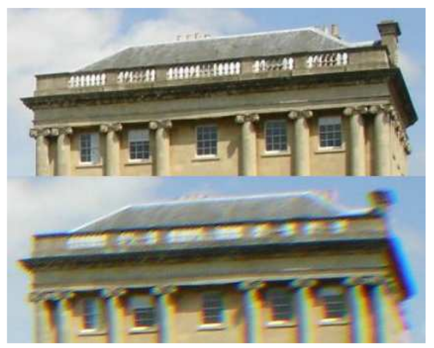

note:

- snelheid licht in een medium is afhankelijk van de golflengte van het licht, dus er is geen brandpunt voor alle kleuren (want refractie-index is variabel en daaruit is de rest afgeleid)

---

## Optische vervorming

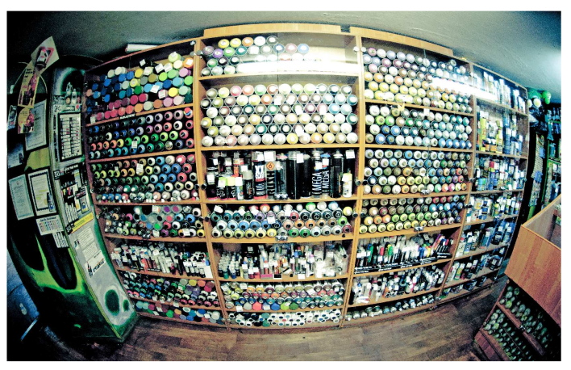

note:

- barrel distortion en pincushion distortion
- elkaars omgekeerde
- barrel distortion treedt makkelijker op bij een brede lens (fisheye lens!)
  - dus als we breed FOV willen ondersteunen, moeten we compenseren!

---

## Werking oog

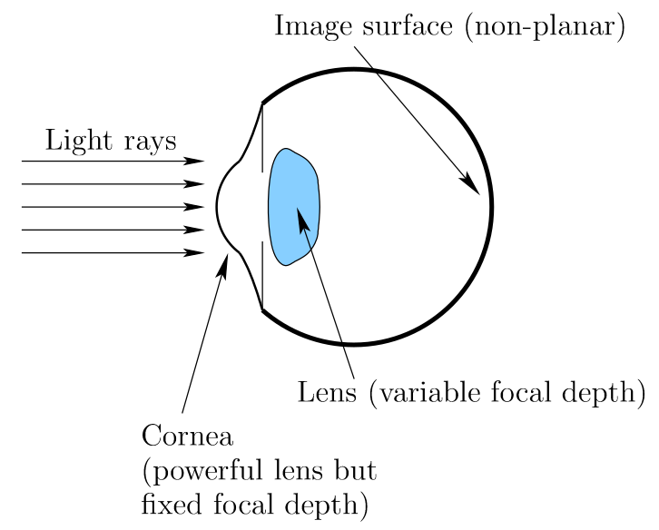

note:

- image surface betekent dat we willen dat dat ons brandvlak is, i.e. dat stralenbundel daar op terecht komt

---

## Verwerking lichtstralen

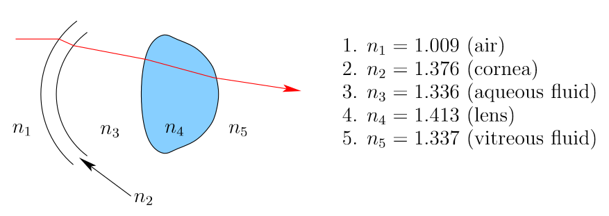
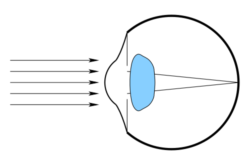
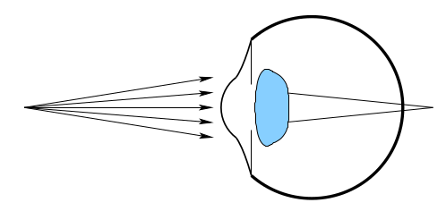
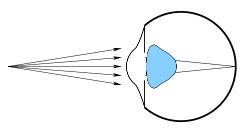

note:

- kunnen dus ook bril dragen onder VR-headset als focale afstand het probleem is

---

## Constructie VR-headset

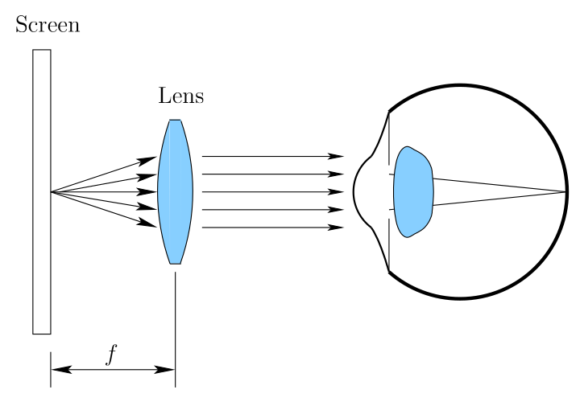

note:

- dit is een VR headset zoals vandaag de standaard is, type Quest
- er zijn andere technologieën, bv. rechtstreeks laser op netvlies ipv display, maar brengen uitdagingen mee
