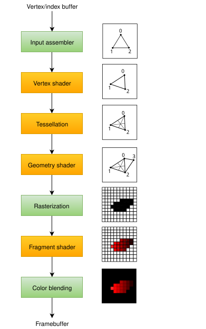
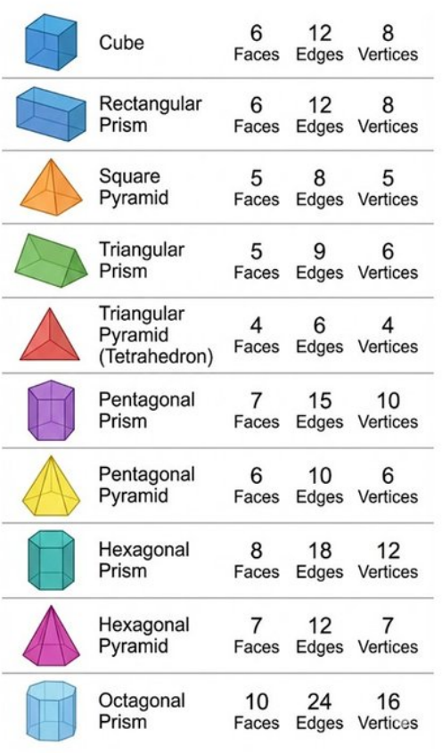
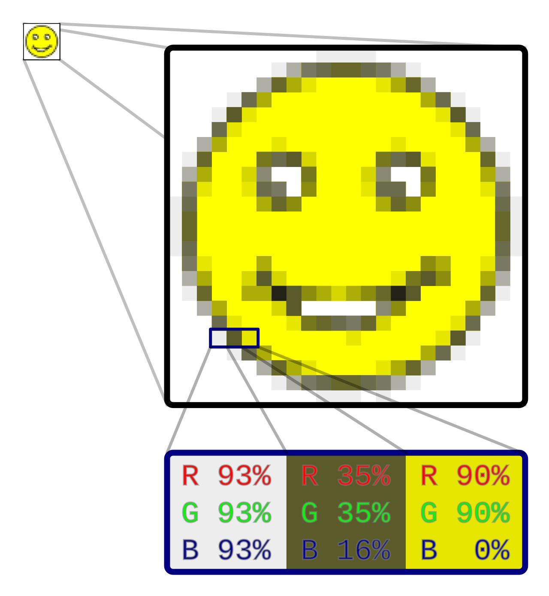

## Shaders

note:

- in labo reeds fade to black via "shader" gedaan
- komen er nog
- dus wat zijn het?

---

## GPU vs. CPU

note:

- meeste van onze **logica** (scripts) op CPU
- **rendering pipeline** op "grafische kaart"
  - belangrijkste kenmerk: parallellisme met beperktere scope

---

## Verklaring

- 1920 x 1080 = 2.073.000 pixels
- elke pixel een kleur
- GPU omvat 1000'en cores

note:

- maar! cores zijn niet zo veelzijdig als CPU cores

---

## Shaders

note:

- shader = programma dat uitvoert op GPU-cores
- beperktere scope ⇒ beperktere programmeertaal (geen C♯ of GDScript)
- verschillende types shaders voeren op verschillende punten in de rendering pipeline uit

---

note:

- pipeline voor Vulkan graphics API
- belangrijk: komen verschillende soorten shaders tegen op verschillende punten in de pipeline
  - GPU kan op verschillende momenten werken met verschillende data

---

## Vertex en fragment shaders

note:

- vertex shaders: beïnvloeden vertices, i.e. punten in onze geometrie (bv. transformaties)
- fragment shaders: na rasterization (i.e. vertaling naar "pre-pixels") kunnen we pixels verwerken
- zijn er nog, bv. light shaders, geometry shaders, particle shaders,...

---

note:

- vertex shader runt per vertex, dus bv. 8 keer voor kubus

---

note:

- fragment shader runt per pixel, dus bv. ongeveer 2 miljoen keer indien onze renderingresolutie 1920x1080 bedraagt
  - heel veel operaties in parallel, niet allemaal achter elkaar dus!

---

<iframe width="560" height="315" src="https://www.youtube.com/embed/lkLyq4HcuFM?si=nYg3TBtEqKjRPHN0" title="YouTube video player" frameborder="0" allow="accelerometer; autoplay; clipboard-write; encrypted-media; gyroscope; picture-in-picture; web-share" referrerpolicy="strict-origin-when-cross-origin" allowfullscreen></iframe>

---

[Godot shading language](https://docs.godotengine.org/en/stable/tutorials/shaders/shader_reference/shading_language.html)

note:

- maakt niet uit of je verder GDScript of C♯ gebruikt, is een aparte taal
- logisch: onze paralleliseerbare operaties zijn veel beperkter
- redelijk wiskundig, maar wel nog variabelen, control flow,...
  - geen objecten, libraries,...
- moet expliciet zijn met types (↔ GDScript), geen automatische typeconversie (↔ GDscript en C♯)
- **belangrijk**: ingebouwde variabelen en functies die verschillen per shadertype
- **opletten**: zorg dat lussen,... niet beginnen lopen terwijl editor open staat, schrijf "startcode" pas op einde!

---

## CanvasItem vs. spatial

note:

- 2D vs 3D
- wat je leert over 2D, draagt over naar 3D (zoals hoe dat in maths for IMT ook was), met wat extra complexiteit in 3D

---

### Voorbeeld 1

note:

- neem Godot logo
- verplaats in bepaalde richting
- pas enkel sommige vertices aan om te stretchen

---

### Voorbeeld 2

note:

- bekijk eerst even [GraphToy](https://graphtoy.com/)
- licht toe: sin(x) schakelt heel voorspelbaar tussen "hoog" en "laag"
  - logisch, komt van beweging op een cirkel
- gebruik om figuur te laten rondbewegen

---

### Voorbeeld 3

note:

- geef gewoon volledige afbeelding vaste kleur

---

### Voorbeeld 4

note:

- toon "RG" gradient

---

### Voorbeeld 5

note:

- gebruik `TEXTURE` en `mix` om kleur een bepaalde tint te geven

---

### Voorbeeld 6

note:

- gebruik eerdere concepten in combinatie met `TIME` om tint te laten variëren

---

## Uniforms

note:

- "shader parameters"
  - bv. `uniform int my_int`
    - kan hintwaarde instellen: `uniform something my_something: hint_range(...,...) = ...`
- vergelijk met exportvariabelen
- in te stellen uit editor of via `....material.set_shader_parameter`

---

### Voorbeeld 7

note:

- pas vorige shader aan zodat tint niet vast ligt, maar zekere fractie RGB krijgt
