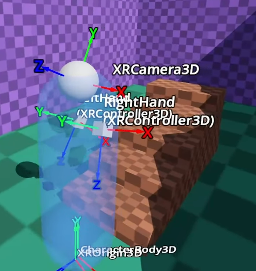
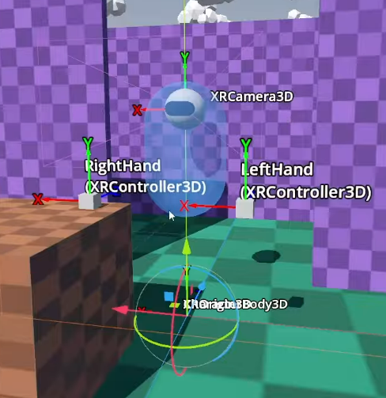
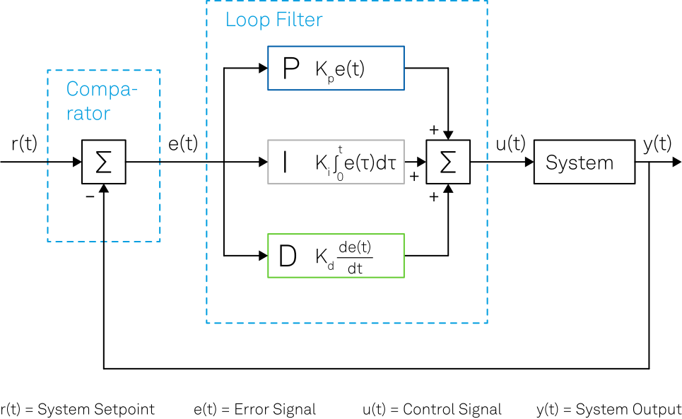
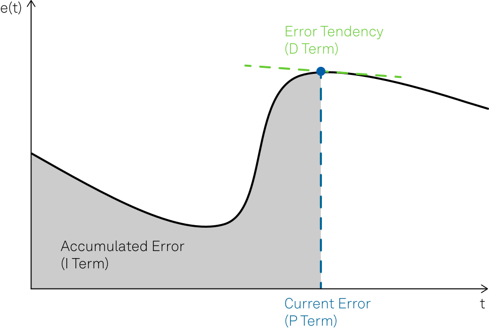
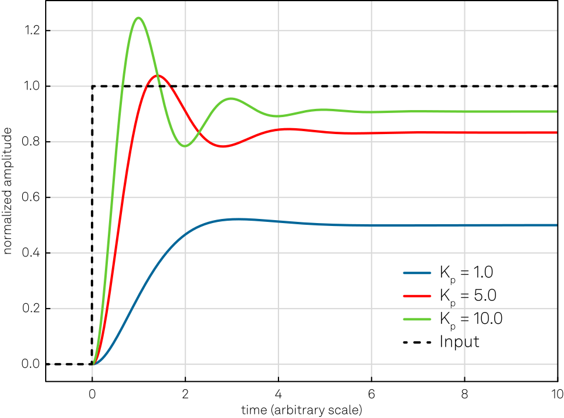
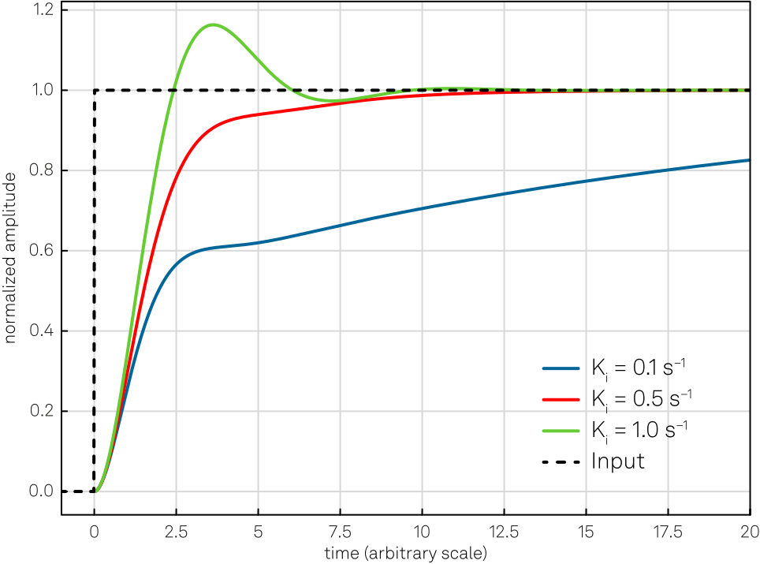
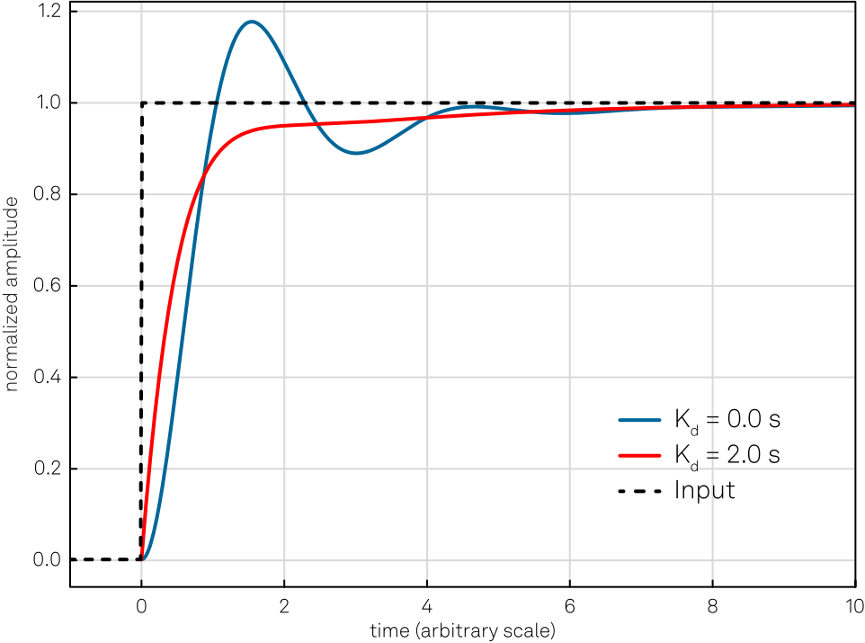
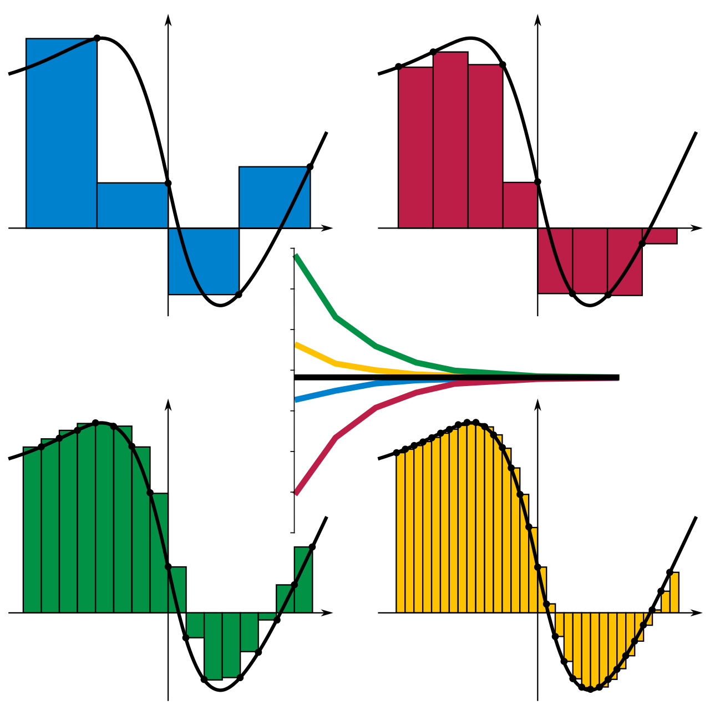

# PID-controllers

note:

- concept dat aan bod komt in video 3 van Bastiaan Olij
- komt voort uit industriële automatisatie
- gebruiken het ook bij robotics
- bedoeling: een waarde constant houden via "vloeiende" correctie

---

- hoogte drone
- thermostaat
- cruise control

note:

- gemeenschappelijk: waarde die niet constant gehouden kan worden door gewoon "hetzelfde" te blijven doen
  - factoren zoals weersomstandigheden, veranderend terrein,...
  - meer/minder vermogen leveren, aan het stuur draaien,... om te corrigeren
- te weinig bijsturen **en** te veel bijsturen brengen ons te ver van de ideale waarde
  - bv. merken dat je 20km/u te snel rijdt betekent dat je moet remmen, maar niet volledig op de rem moet gaan staan
    - hoe hard hangt af van bergop/bergaf/wegdek/...
- niet vanuit buikgevoel benaderen: PID controller "ontdekt" hoe veel we op een gegeven moment moeten bijstellen
  - geen "perfecte" oplossing, tuning van de parameters heeft nog altijd invloed op kwaliteit

---

  
  

note:

- zullen enkel bovenlichaam voorzien van collision shape
- anders zitten we vast tegen trappen
- willen niet omhoog / omlaag teleporteren zodra we op een trede (of ervan af) stappen, willen dat onze hoogte **vloeiend** wordt aangepast
  - onmiddellijke correctie zou ongeveer zijn zoals met fiets trap afrijden (of oprijden als dat ging)
  - constante snelheid zou spookachtig aanvoelen
  - lineaire versnelling zou natuurlijk vallen of stijgen maar abrupt stoppen
- oplossing: afwijking corrigeren door "duwtje" naar zekere hoogte boven de grond te geven, ongeveer zoals hoe drone op zekere hoogte hovert

---

note:

- "controller" is eigenlijk een programma dat bedoeld is om ons bij zekere targetwaarde te houden
  - in ons geval de ideale hoogte boven de grond, ongeveer de lengte van onze benen dus
  - thermostaat: kamertemperatuur of industriële temperatuur
  - hoogte drone: gewenste vlieghoogte
  - cruise control: gelijke afstand tussen linker- en rechterrand rijstrook

---

- $r(t)$: setpoint
- $y(t)$: meetwaarde
- $e(t) = r(t) - y(t)$

note:

- lees $(t)$  als "op een gegeven moment in de tijd"
- ideale geval is dat e(t) 0 bedraagt

---

note:

- overzicht van relatie tussen de errorfunctie, haar afgeleide en haar integraal
- intuïtief: errorfunctie zegt iets over "heden" (tijdstip t), afgeleide voorspelt "toekomst" (e bij volgende waarden van t), integraal vertelt iets over "verleden" (e geaccumuleerd over eerdere waarden van t)
- intuïtief: als er **nu** een afwijking is, betekent dat waarschijnlijk dat we moeten corrigeren
  - bv. als onze drone nu op 10m hangt en hij moet op 20 zitten, betekent die afwijking van -10m dat we een tandje moeten bijsteken, ook al zitten we stabiel
  - dus er is een bijdrage van de proportionele term
- intuïtief: als er een afwijking **verwacht** wordt, kunnen we anticiperen
  - bv. als onze drone van 25m komt maar in vrije val is, zouden we snel onder de 20m kunnen vallen
  - dus er is een bijdrage van de afgeleide term
- intuïtief: als er constante arbeid nodig is, kunnen we door geleidelijk op te voeren achterhalen hoe veel genoeg is
  - bv.: door geleidelijk het geleverde motorvermogen op te voeren, kunnen we de drone laten hoveren
    - als we niet dat minimum leveren, compenseren we de automatische daling niet
    - we kunnen het minimum ontdekken door heel langzaam bij te duwen

---

note:

- normalized amplitude = verhouding van de proceswaarde tot de setpointwaarde, 1 betekent dat ze gelijk zijn
- wat gebeurt als we "licht" corrigeren op basis van huidige afwijking, "middelmatig" of "sterk"
- bv. drone puur bijsturen op basis van huidige hoogte, zonder rekening te houden met valsnelheid of ideale vermogen om te hoveren
- de waarden K_p zijn voorbeeldwaarden en zijn per proces anders (PID tuning!)

---

note:

- opnieuw: sterk in rekening brengen, middelmatig, een beetje
- meeteenheid staat bij constante om terug tot een som van eenheidloze waarden te komen, s^(-1) betekent "per seconde" want we hebben een vermenigvuldiging met een zekere hoeveelheid tijd gedaan

---

note:

- weergave voor enkel naar de verandering te kijken
- blauwe lijn toont hier hoe proces evolueert als we de factor buiten beschouwing laten, want staat op 0
- rode lijn toont stabieler gedrag omdat we bijsturen

---

## PID tuning

note:

- hebben dus drie termen waarvan we vinden dat ze een bijdrage leveren in hoe sterk we moeten bijstellen
  - coëfficiënten zeggen eigenlijk hoe veel gewicht elke term krijgt en variëren dus per proces
- PID tuning = optimaliseren van de coëfficiënten voor een gegeven proces
  - buiten scope

---

note:

- verschillende manieren om afgeleide/integraal te zien, leveren identiek resultaat als de blokjes smal genoeg worden
- implementatie gebruikt benadering
- huidige waarde: via rechtstreekse meting
  - bv. voor voorbeeld Bastiaan: afstand tussen collision body en oppervlak onder body gewoon meten
- afgeleide: hebben geen symbolische voorstelling van de errorfunctie, maar "dt" uit een afgeleide stemt overeen met ons concept van "delta time" (alleen is de symbolische variant "oneindig klein")
  - dus we moeten gewoon de vorige waarde onthouden
- integraal: som van alle eerdere balkjes, dus die moeten we onthouden
  - balkjes onder de as compenseren die boven de as, dus zouden kunnen de som over de hele duur van het programma nemen
  - Bastiaan voorziet wel een limiet op de totaalsom (in zowel positieve als negatieve richting)

---

## Andere toepassingen in VR

- objectmanipulatie
- simulaties industriële toepassingen
- voertuigsimulaties
- stabilisatie van instrumenten voor teleoperatie

note:

- objectmanipulatie gebruikt combinatie van tracking (handen) en physics (objecten), moeten bv. vermijden dat voorwerp opeens "in onze hand" gedetecteerd wordt (door het terug in positie te brengen)
- PID-controllers komen uit industriële automatisatie
- voertuigsimulaties: cruise control, aanhouden tempo gebruiken deze concepten
- teleoperatie: willen niet dat camera heel de tijd schudt, kunnen op deze manier stabiliseren

---

# Truukjes Bastiaan

---

- origin node: punt in de wereld dat gemapt wordt op punt in echte wereld, fysiek rondwandelen zou dit niet mogen verplaatsen (maar wel onze player collision shape, want anders kunnen we door muren wandelen)
  (- beweging met controller moet origin **en** player collision shape beïnvloeden maar onze player collsion shape moet ons wel volgen, dus tijdens beweging met de controller moeten we
    - oplossing: fysieke beweging: zoals beweging met controller, maar bij elke verplaatsing zetten we de origin terug
      - implementatie: )

- axis subscene: elk punt is ergens in world space, maar we kunnen ook zien in local space ten opzichte van parent
  - axis subscene bevindt zich in de oorsprong in local space en assen zijn de **geroteerde** assen van de parent
  - dus toont in-game hoe onze lokale assen staan

