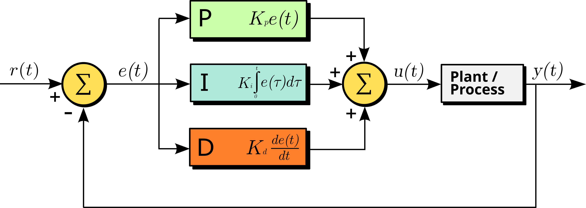

# PID-controllers

note:

- concept dat aan bod komt in video 3 van Bastiaan Olij
- komt voort uit industriële automatisatie
- gebruiken het ook bij robotics
- bedoeling: een waarde constant houden via "vloeiende" correctie

---

- hoogte drone
- thermostaat
- cruise control

note:

- gemeenschappelijk: waarde die niet constant gehouden kan worden door gewoon "hetzelfde" te blijven doen
  - factoren zoals weersomstandigheden, veranderend terrein,...
  - meer/minder vermogen leveren, aan het stuur draaien,... om te corrigeren
- te weinig bijsturen **en** te veel bijsturen brengen ons te ver van de ideale waarde
  - bv. merken dat je 20km/u te snel rijdt betekent dat je moet remmen, maar niet volledig op de rem moet gaan staan
    - hoe hard hangt af van bergop/bergaf/wegdek/...
- niet vanuit buikgevoel benaderen: PID controller "ontdekt" hoe veel we op een gegeven moment moeten bijstellen

---

note:

- zullen enkel bovenlichaam voorzien van collision shape
- anders zitten we vast tegen trappen
- willen niet omhoog / omlaag teleporteren zodra we op een trede (of ervan af) stappen, willen dat onze hoogte **vloeiend** wordt aangepast
  - onmiddellijke correctie / constante snelheid / lineaire versnelling zouden allemaal onnatuurlijk effect opleveren, zeker als de targetvalue regelmatig verandert

---

note:

- "controller" is eigenlijk een programma dat bedoeld is om ons bij zekere targetwaarde te houden
  - in ons geval de ideale hoogte boven de grond, ongeveer de lengte van onze benen dus
  - thermostaat: kamertemperatuur of industriële temperatuur
  - hoogte drone: gewenste vlieghoogte
  - cruise control: gelijke afstand tussen linker- en rechterrand rijstrook

---

- $r(t)$: setpoint
- $y(t)$: meetwaarde
- $e(t) = r(t) - y(t)$

note:

- lees $(t)$  als "op een gegeven moment in de tijd"
- ideale geval is dat e(t) 0 bedraagt
